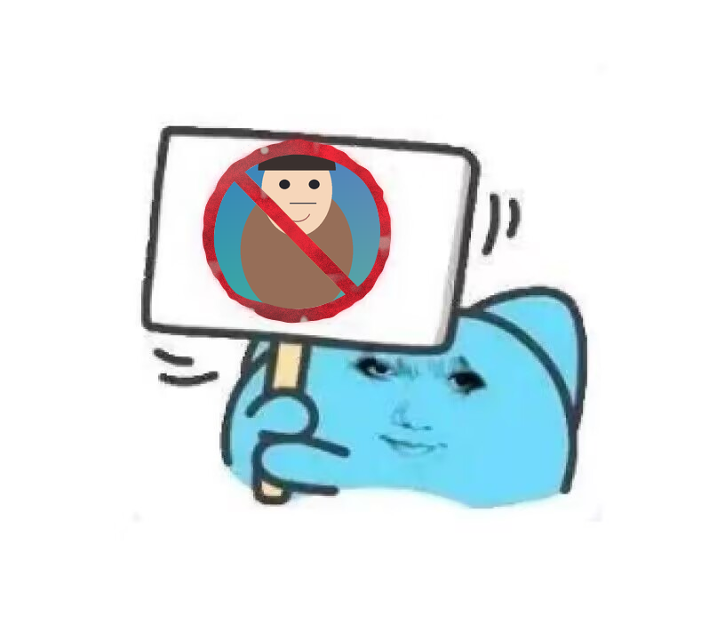

# 禁止表情包生成器

拖一张图片或动图进去，它会替换掉牌子里的黄色奶龙，并加上红色禁止标志。
**动图进，动图出**：给 GIF 就导出 GIF（保留帧数、每帧时长，无限循环）。

**在线使用**：<https://fallingcb.github.io/image-ban-generator/>
—— 纯静态页面，不用装任何东西，图片不会上传到任何服务器。

也可以离线用：双击 **`ban-sticker.html`**（单个文件，约 570 KB，内置全部素材）。



## 用法

1. 双击 `ban-sticker.html`，用 Chrome / Edge 打开。
2. 把图片或 GIF 拖进页面（也可以点击选择，或 `Ctrl`+`V` 粘贴）。**动图会在预览里直接
   按自己的帧速循环播放**，调位置时看到的就是最后导出的效果。
3. 在右边面板微调：
   - **大小 / 水平位置 / 垂直位置 / 旋转** —— 也可以在预览图上直接拖动、滚轮缩放。
     拖动**没有边界限制**（不会卡在画布边上）；拖太远时两个位置滑杆会自动加长跟着走，
     点 **重置位置** 一键回中。
   - **描边粗细** —— 图片没盖满圆圈时给它加白色贴纸描边，`0` 表示关闭（图片盖满时描边被红环挡住，看不见）。
   - **保留斜杠** —— 取消勾选就只留红圈。
   - **导出设置** —— 输出尺寸、GIF 帧率上限 / 最大帧数 / 调色板颜色数。
4. 点 **下载表情包**：静态图导出 PNG，动图导出 GIF（**永远循环播放**）。

拖动图片时不会误弹出"选文件"对话框；要换图请点 **换一张**，或在没有图片时点空白区域。

所有处理都在浏览器本地完成，不联网、不上传。

## 实现要点

- 素材由原图程序化生成（`tools/build_assets.py`）：
  - `assets/template.png` —— 把奶龙擦成纯白后的模板底图（擦除边界跟着手绘圆环的内沿走）；
  - `assets/overlay.png` —— 红色圆环 + 斜杠，**外加圆环外侧原图的牌面**；
  - `assets/slashmask.png` —— 斜杠那一小片，供"只留红圈"时擦除。
- **红环做旧**：整环刷成一片均匀的红，会像矢量图贴在照片上。所以环和斜杠的红色是
  按墨迹密度画出来的（`tools/build_assets.py` 里的 multi-scale 噪声）：大块浓淡、中等
  斑驳、细齿纹，加上褪色发白的地方和几处真正磨掉露出底板的缺口，外沿还被噪声啃出
  毛边。做旧只改**颜色**，overlay 的 alpha（真正把图片关在环里的东西）一个像素都没动，
  所以不可能影响"不漏图"这条底线。环内实测亮度标准差 16.6，原照片那一圈是 30.2
  （flat 重绘则是 0）—— 差距太大正是"格格不入"的来源。
- 合成顺序：底图 → 用户图片（裁到 `clip_r` 的圆内）→ overlay。所以斜杠永远压在图片上面。
- **图片的圆形裁切边界藏在红环下面**：overlay 上圆环内沿以内的部分是透明的，圆环本身就是遮挡，
  所以无论图片怎么缩放/拖动，都不会露出红环外面（这是之前那版最严重的 bug：量出来的圆环比
  实际画的圆环外沿小，图片从环外漏出一圈）。
- 量出来的几何写入 `tools/geometry.json`，再由 `tools/build_page.py` 直接注入页面，
  页面里不再手写任何几何常量 —— 素材和页面不可能再对不上。
  - 圆环内沿/外沿按 48 个角度分别测量，保留手绘的粗细与椭圆抖动；
  - 圆心 `(333.9, 260.14)`，内沿 `86.2..97.1`，外沿 `101.7..106.5`（中位数 `90.9 / 104.1`）；
  - `cover_r = 99.05`：自动缩放（"重置位置"）保证图片最短边也盖到这么大，任何长宽比都不留白；
  - `clip_r = 110.47`、`disc_r = 112.47`：裁切半径 < overlay 不透明范围，天生不会漏。
- 动图用浏览器原生 `ImageDecoder` 逐帧解码，再用页面内自带的 GIF89a 编码器（LZW + 中位切分调色板）重新编码。
  编码器的码宽变化严格对齐解码器行为，已用 Pillow 逐像素校验（见下）。
  - 解码前必须 `await decoder.tracks.ready`：`tracks.selectedTrack` 在那之前是 `null`，
    直接读 `codedWidth` 会抛异常，所有 GIF 都会"读取失败"（这个 bug 已经修掉，并由下面的
    `gif_e2e.py` 端到端守住）。
  - 导出分两遍：第一遍逐帧渲染只取颜色样本（均匀铺满**每一帧**，而不是被第一帧占满），
    生成调色板；第二遍重新渲染并直接量化成索引帧。旧写法会把每一帧的 RGBA 全留着，
    150 帧满尺寸约 348 MB；现在每像素 1 字节。
  - LZW 用整数键 `(前缀码 << 8) | 符号` 查字典，不再对每个像素拼字符串键和数组，
    同样的输出字节快约 3 倍。
  - 编码时写入 `NETSCAPE2.0` 应用扩展、循环次数 `0`（无限循环）。不写这一段，
    解码器有权"播一次就停"，表情包就不会自己转回来了。
  - 预览直接按每帧自己的 delay 循环播放（不走 `requestAnimationFrame`：它被节流或
    页面不在合成时根本不触发，动画会卡住）。

## 重新生成 / 修改

```cmd
python tools\build_assets.py     REM 从 template-source.jpg 重新生成素材
python tools\build_page.py       REM 把素材内联进 ban-sticker.html + index.html
tools\run_tests.cmd              REM 跑全部校验
```

改界面或逻辑请编辑 `src/app.template.html`，然后执行 `python tools\build_page.py` 重新打包。
所有脚本都按自身位置定位仓库根目录，克隆到任何路径都能直接跑。

## 部署（GitHub Pages）

仓库根目录**就是**网站根目录，不需要构建步骤，也不需要 GitHub Actions：

| 文件 | 用途 |
| --- | --- |
| `index.html` | 网站入口，`https://<用户名>.github.io/image-ban-generator/` |
| `ban-sticker.html` | 本地双击用的同一个文件 |
| `.nojekyll` | 关掉 Jekyll，静态文件原样发布 |

`index.html` 和 `ban-sticker.html` 是**字节完全相同**的两份：`tools/build_page.py` 一次写两个，
git 对相同内容只存一份 blob，所以体积不变，也不会互相漂移。

Pages 设置：**Settings → Pages → Source: Deploy from a branch → `main` → `/ (root)`**。

改了页面之后重新发布：

```cmd
python tools\build_page.py
git add -A && git commit -m "rebuild" && git push
```

推上去后 GitHub Pages 会在 1 分钟左右自动重新发布。

## 校验

`tools\run_tests.cmd` 依次执行：

| 脚本 | 内容 |
| --- | --- |
| `tools/test_core.js` | 中位切分调色板质量；GIF 编码器输出经严格解析器还原，逐像素一致（含跨 512/1024/2048 码表的码宽跳变） |
| `tools/test_page.js` | 页面几何与 `geometry.json` 完全一致、内联资源完整、缩放/偏移/旋转摆放计算、各长宽比的自动缩放都盖满圆圈 |
| `tools/make_test_gifs.js` + `tools/verify3.py` | 用 JS 编码 6 个用例（2 帧、40 万像素高熵、半透明、256 色+透明等），再用独立解码器和 Pillow 双向核对 |
| `tools/render_sample.py` | 生成 `sample-output.png` 示例图 |
| `tools/browser_test.py` | 用无头 Edge 真的跑一遍页面的 `paint()`：喂纯绿+品红的测试图，截图后逐像素检查"红环外绝不出现图片像素""圆内不留白""圆环完整"；覆盖 4 种长宽比、预览尺寸、2× 导出、以及关闭斜杠。找不到 Edge/Chrome 时自动跳过 |
| `tools/gif_e2e.py` | 用无头 Edge 走**真实界面**：把真 GIF 塞进文件输入框（和拖拽同一条代码路径）→ 检查预览真的在动、导出 GIF 请求无限循环、拖完不弹选文件框、拖动不再被 ±200 卡住 → 点"下载表情包" → 从 DOM 里取回导出的 blob → 用 Pillow 校验帧数、尺寸、帧间真的在动、红环还在。找不到 Edge/Chrome 时自动跳过 |

辅助脚本：`analyze_template.py` / `analyze_template2.py`（量圆环）、`dump_gif.py`（看 GIF 结构）、`refdec.py`（参考解码器）。
端到端测试跑完会在 `tools/_browsertest/shot.png` 留下一张截图，可以直接看（这个目录是生成的，不在版本库里）。

## 已知限制

- 动图解码依赖 `ImageDecoder`（Chrome / Edge 86+）。其他浏览器打开 GIF 会提示并按静态图处理。
- GIF 只有一级透明：半透明像素默认铺白底（可关掉，关掉后完全透明的像素才透明）。
- 帧数很多的大 GIF 导出仍然要花时间（有进度条）：每帧要渲染两遍，受"GIF 最大帧 / 输出尺寸"限制。
  超过"最大帧"时会等间隔抽帧，并把被抽掉那几帧的时长累加到保留的那一帧上，总时长不变。
- 输入图片的背景不会自动抠掉；图片按原样贴进圆圈，需要的话用透明 PNG，或调整大小/位置。
- 圆环是照原图重画的，并且做了做旧处理：原图是二次压缩的 JPEG，环本身的红偏暗（约 `#A04B55`），
  这里以更干净的红 `#BE202D` 为基准墨色，再叠加浓淡、磨损和毛边。所以环的**最外沿**还留着
  一圈原图的淡红描边（放大才看得出）。
- 做旧参数是手调的艺术效果，不是测量结果；想更干净或更破旧，改 `tools/build_assets.py`
  里 "aged ink" 那一段的系数即可，脚本每次会打印环内亮度标准差和磨损面积占比，
  方便对照着调（原照片那一圈是 ~30 / 磨损看 `worn %`）。
